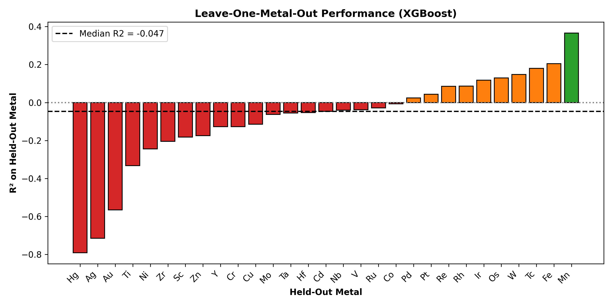

# Benchmarking the Out-of-Distribution Extrapolation Limits of Non-Spatial ML Models on tmQM

> Predicting the HOMO–LUMO gap of transition-metal complexes from composition alone — and where that fails.

[](https://www.python.org/)
[](LICENSE)

**Status:** limits paper in preparation. This repo is the benchmark behind
that paper: every route tried so far fails to transfer to unseen metals, and
the numbers below are the verified evidence. The full 3-seed rerun of the
main pipeline finished on 2026-11-27 (see "Reproducing the results").

## Core finding

Non-spatial models barely predict the tmQM HOMO–LUMO gap, even when they are
given help. The best model (Random Forest on Morgan fingerprints) reaches
**R² = 0.387 on a random split** and collapses to **R² = 0.184 on grouped
(by-metal) splits** (3-seed means; full table below). Under
leave-one-metal-out, the median metal scores **R² = −0.025** (Random Forest;
XGBoost −0.012) — worse than predicting the mean. Cheap xTB-only features
fail outright (R² ≈ 0.03, Random Forest −0.20). Adding simple 3D geometry
helps on random splits (R² 0.44) but does **not** fix transfer to new metals
(grouped R² 0.03–0.16 across two independent samples). The gap is not
predictable from these inputs, and it does not transfer to unseen metals.

## Read this first — what the numbers do and do not mean

- **The 5 "DFT scalars" are oracle features, not screening features.**
  `Electronic_E`, `Dispersion_E`, `Dipole_M`, `Metal_q` (and `Polarizability`)
  come from the same TPSSh calculation as the HOMO–LUMO gap itself. A model
  using them is a DFT-to-DFT mapping: it cannot be used to screen new complexes
  without first running the expensive calculation it is supposed to replace.
  The feature-importance file proves the point — the model leans almost
  entirely on these five numbers (see below).
- **The honest screening numbers are the structure-only ones** (RDKit 2D
  descriptors, Morgan fingerprints). They are no better: RDKit 2D Random
  Forest reaches R² 0.379 random / 0.149 grouped.
- **Morgan-fingerprint results are verified — by a fresh rerun.** The
  earlier version of this README quoted Morgan FP numbers (R² 0.386 random /
  0.201 grouped) with no source table in the bundle, so they were removed.
  On 2026-11-27 the pipeline was rerun end-to-end and reproduced those
  numbers to within 0.001 (see `results/results_cv_reproduced.csv`). The
  Morgan table is therefore restored below. Note the rerun used **256-bit**
  fingerprints; the surviving `X_morgan.parquet` is 1024-bit from a
  different run and is not the file this table used.
- **Two unit systems are mixed in the files.** `benchmark_results.csv` and
  `results_cv.csv` report errors in **eV**; `model_results.csv` reports the
  same runs with the target in **Hartree** (RMSE ≈ 0.027 Ha ≈ 0.75 eV).
  R² is identical in both; only the error scale differs.

## Dataset and features

- **Source:** tmQM dataset, HOMO–LUMO gap (`HL_Gap`) from TPSSh calculations.
- **Complexes:** 108,541 in total; **100,831** with valid SMILES (the rest
  drop out of any SMILES-based featurisation, which is why the N differs
  between runs below).
- **Target:** `HL_Gap_eV` = `HL_Gap` × 27.2114. Mean 2.97 eV, std 0.91 eV,
  range 0.06–8.37 eV (N = 100,831).
- **Feature sets:**
  - 5 DFT scalars: `Electronic_E`, `Dispersion_E`, `Dipole_M`, `Metal_q`,
    `Polarizability` (same calculation as the target — see the caveat above).
  - RDKit 2D: 14 descriptors (MolWt, LogP, TPSA, …).
  - Morgan fingerprints: 1024 bits (feature file only; no results table here).
  - xTB-only: as recorded in `benchmark_results.csv`; its feature file is not
    in this bundle.

## Benchmark results

### Random 80/20 splits, seeds 42 / 123 / 2024 (N = 108,541; train 86,832, test 21,709)

From `results/benchmark_results.csv` (seed 42 shown; the range over the three
seeds is in brackets).

| Features | Model | R² | RMSE (eV) | MAE (eV) |
|---|---|---|---|---|
| DFT-assisted (5 scalars) | Dummy (mean) | 0.000 | 0.916 | 0.708 |
| DFT-assisted (5 scalars) | Ridge | 0.086 | 0.876 | 0.671 |
| DFT-assisted (5 scalars) | Random Forest | **0.334** [0.322–0.336] | 0.748 | 0.560 |
| DFT-assisted (5 scalars) | XGBoost | 0.274 [0.263–0.277] | 0.781 | 0.600 |
| xTB-only | Dummy (mean) | 0.000 | 0.916 | 0.708 |
| xTB-only | Ridge | 0.019 | 0.908 | 0.703 |
| xTB-only | Random Forest | −0.200 | 1.004 | 0.781 |
| xTB-only | XGBoost | 0.031 | 0.902 | 0.698 |

### 5-fold cross-validation, rerun 2026-11-27 (from `results/results_cv_reproduced.csv`)

Aligned set: 100,831 complexes with valid SMILES, known metals only, 30
metals, median gap 2.98 eV. Random = 5-fold KFold; grouped = 5-fold
GroupKFold by metal. Morgan fingerprints are 256-bit here. The mean baseline
scores R² 0.000 (random) and −0.006 (grouped).

| Split | Features | Model | R² | RMSE (eV) | MAE (eV) |
|---|---|---|---|---|---|
| random | 5 scalars | Ridge | 0.082 | 0.869 | 0.666 |
| random | 5 scalars | Random Forest | 0.299 | 0.759 | 0.579 |
| random | 5 scalars | XGBoost | 0.271 | 0.774 | 0.595 |
| random | RDKit 2D | Ridge | 0.116 | 0.853 | 0.659 |
| random | RDKit 2D | Random Forest | 0.309 | 0.754 | 0.571 |
| random | RDKit 2D | XGBoost | 0.271 | 0.774 | 0.592 |
| random | Morgan FP (256) | Ridge | 0.256 | 0.782 | 0.597 |
| random | Morgan FP (256) | Random Forest | **0.386** | 0.711 | 0.527 |
| random | Morgan FP (256) | XGBoost | 0.374 | 0.718 | 0.537 |
| grouped (by metal) | 5 scalars | Ridge | 0.032 | 0.892 | 0.684 |
| grouped (by metal) | 5 scalars | Random Forest | 0.096 | 0.862 | 0.664 |
| grouped (by metal) | 5 scalars | XGBoost | 0.118 | 0.851 | 0.655 |
| grouped (by metal) | RDKit 2D | Ridge | 0.056 | 0.881 | 0.681 |
| grouped (by metal) | RDKit 2D | Random Forest | 0.143 | 0.840 | 0.641 |
| grouped (by metal) | RDKit 2D | XGBoost | 0.147 | 0.838 | 0.641 |
| grouped (by metal) | Morgan FP (256) | Ridge | 0.134 | 0.844 | 0.650 |
| grouped (by metal) | Morgan FP (256) | Random Forest | 0.184 | 0.819 | 0.623 |
| grouped (by metal) | Morgan FP (256) | XGBoost | **0.201** | 0.811 | 0.617 |

This rerun reproduces the numbers the old README reported to within 0.001
on every row — that is why the Morgan table is back. Note these numbers
differ from the older `results_cv.csv` table (5 scalars RF 0.330, RDKit RF
0.379): that file comes from a different run with different model settings,
and both are kept in `results/` with their sources documented. Do not mix
the two tables.

### 5-fold cross-validation, FINAL 3-seed run 2026-11-27 (from `results/results_all_runs.csv` and `results/results_final.csv`)

The full run: seeds 0, 1, 2, 5-fold, aligned set 100,831 complexes, 30
metals. Values are the mean over the 3 seeds (± std). This table supersedes
the single-seed rerun above — its seed-0 values agree with these means to
within 0.001 on every row.

| Split | Features | Model | R² (mean ± std) | RMSE (eV) | MAE (eV) |
|---|---|---|---|---|---|
| random | 5 scalars | Mean baseline | −0.000 ± 0.000 | 0.907 | 0.702 |
| random | 5 scalars | Ridge | 0.082 ± 0.000 | 0.869 | 0.666 |
| random | 5 scalars | Random Forest | 0.299 ± 0.000 | 0.759 | 0.579 |
| random | 5 scalars | XGBoost | 0.271 ± 0.000 | 0.774 | 0.595 |
| random | RDKit 2D | Mean baseline | −0.000 ± 0.000 | 0.907 | 0.702 |
| random | RDKit 2D | Ridge | 0.116 ± 0.000 | 0.853 | 0.659 |
| random | RDKit 2D | Random Forest | 0.307 ± 0.001 | 0.755 | 0.572 |
| random | RDKit 2D | XGBoost | 0.271 ± 0.001 | 0.774 | 0.592 |
| random | Morgan FP (256) | Mean baseline | −0.000 ± 0.000 | 0.907 | 0.702 |
| random | Morgan FP (256) | Ridge | 0.256 ± 0.000 | 0.782 | 0.597 |
| random | Morgan FP (256) | Random Forest | 0.387 ± 0.001 | 0.710 | 0.526 |
| random | Morgan FP (256) | XGBoost | 0.373 ± 0.001 | 0.718 | 0.537 |
| grouped (by metal) | 5 scalars | Mean baseline | −0.006 ± 0.000 | 0.909 | 0.704 |
| grouped (by metal) | 5 scalars | Ridge | 0.032 ± 0.000 | 0.892 | 0.684 |
| grouped (by metal) | 5 scalars | Random Forest | 0.095 ± 0.002 | 0.863 | 0.664 |
| grouped (by metal) | 5 scalars | XGBoost | 0.118 ± 0.000 | 0.851 | 0.655 |
| grouped (by metal) | RDKit 2D | Mean baseline | −0.006 ± 0.000 | 0.909 | 0.704 |
| grouped (by metal) | RDKit 2D | Ridge | 0.056 ± 0.000 | 0.881 | 0.681 |
| grouped (by metal) | RDKit 2D | Random Forest | 0.143 ± 0.000 | 0.839 | 0.641 |
| grouped (by metal) | RDKit 2D | XGBoost | 0.146 ± 0.000 | 0.838 | 0.641 |
| grouped (by metal) | Morgan FP (256) | Mean baseline | −0.006 ± 0.000 | 0.909 | 0.704 |
| grouped (by metal) | Morgan FP (256) | Ridge | 0.134 ± 0.000 | 0.844 | 0.650 |
| grouped (by metal) | Morgan FP (256) | Random Forest | 0.184 ± 0.001 | 0.819 | 0.623 |
| grouped (by metal) | Morgan FP (256) | XGBoost | 0.201 ± 0.000 | 0.811 | 0.617 |

### Older cross-validation summary (from `results/results_cv.csv`)

Kept for completeness; a different run from the table above (see
`docs/tmqm_benchmark_report.md`).

| Split | Features | Model | N | R² | RMSE (eV) |
|---|---|---|---|---|---|
| random | 5 scalars | Ridge | 108,541 | 0.082 | 0.875 |
| random | 5 scalars | Random Forest | 108,541 | 0.330 | 0.748 |
| random | 5 scalars | XGBoost | 108,541 | 0.271 | 0.780 |
| random | RDKit 2D | Ridge | 100,831 | 0.116 | 0.852 |
| random | RDKit 2D | Random Forest | 100,831 | 0.379 | 0.715 |
| random | RDKit 2D | XGBoost | 100,831 | 0.271 | 0.774 |
| grouped (by metal) | 5 scalars | Ridge | 100,849 | 0.032 | 0.892 |
| grouped (by metal) | 5 scalars | Random Forest | 100,849 | 0.070 | 0.874 |
| grouped (by metal) | 5 scalars | XGBoost | 100,849 | 0.126 | 0.848 |
| grouped (by metal) | RDKit 2D | Ridge | 100,831 | 0.056 | 0.881 |
| grouped (by metal) | RDKit 2D | Random Forest | 100,831 | 0.149 | 0.836 |
| grouped (by metal) | RDKit 2D | XGBoost | 100,831 | 0.149 | 0.837 |

Note the N differences: the 5-scalar runs use all 108,541 rows (scalars need no
SMILES); RDKit runs use the 100,831 rows with valid SMILES. The grouped
5-scalar N (100,849) differs slightly from the random N — the runs come from
different pipeline stages, so treat the two tables as two recorded runs, not
one perfectly matched experiment. See `docs/tmqm_benchmark_report.md`.

### Leave-one-metal-out (from `results/per_metal_results.csv`)

Full run, 2026-11-27: 30 metals × 4 models = 120 rows, 5-scalar features
only, min N = 100. Median R² over held-out metals: **Random Forest −0.025,
XGBoost −0.012, Ridge −0.026, mean baseline −0.090**. Only 13 of 30 metals
score above zero with Random Forest. Best: Mn 0.35 (RF) / 0.38 (XGBoost).
Worst: Ag −0.73 (RF), Hg −0.77 (XGBoost), Au −0.53 (RF).

> Correction: an earlier version of this README quoted a median of −0.048,
> read from the old `per_metal_r2.png`. The verified rerun gives −0.025
> (Random Forest). The conclusion is unchanged — the median metal is still
> below zero — but the number is now from the table, not the figure.

| Metal | N | R² (Random Forest) |
|---|---|---|
| Mn | 2112 | 0.346 |
| Fe | 5045 | 0.244 |
| Tc | 283 | 0.207 |
| Os | 1224 | 0.121 |
| W | 3199 | 0.120 |
| Ir | 4695 | 0.105 |
| Rh | 4278 | 0.089 |
| Re | 4033 | 0.083 |
| Pt | 7853 | 0.038 |
| Pd | 10161 | 0.023 |
| Co | 3450 | 0.019 |
| Nb | 516 | 0.004 |
| Mo | 3868 | 0.000 |
| V | 1380 | −0.020 |
| La | 116 | −0.024 |
| Ru | 9067 | −0.027 |
| Hf | 572 | −0.059 |
| Cd | 1643 | −0.078 |
| Ta | 740 | −0.084 |
| Y | 817 | −0.115 |
| Cu | 3528 | −0.123 |
| Zr | 2640 | −0.130 |
| Cr | 2033 | −0.147 |
| Ni | 10030 | −0.217 |
| Sc | 459 | −0.243 |
| Zn | 7043 | −0.270 |
| Ti | 3131 | −0.314 |
| Au | 4099 | −0.531 |
| Hg | 1148 | −0.675 |
| Ag | 1668 | −0.728 |

### 3D geometry test (2026-11-27, from `results/results_3d_test.csv`)

The one route that could have rescued the project was 3D structure: a flat
SMILES string cannot see a metal complex's shape, so simple 3D features were
built from the xyz coordinates (coordination number, metal–ligand bond-length
statistics, donor composition, ligand–metal–ligand angles, metal properties —
~30 features) and tested against the 256-bit Morgan baseline on the same
5,000-complex samples and the same splits. Two independent samples were run
(seed 0 in Colab, seed 1 reproduced on a second machine); the cell is
`colab_3d_test_paste.txt`.

On random splits 3D clearly helps (XGBoost R² 0.44 vs Morgan 0.25, and 0.50
combined). On grouped splits — new metals, the test that matters — it does
not:

| Split | Features | Model | R² (seed 0) | R² (seed 1) |
|---|---|---|---|---|
| grouped | 3D only | Random Forest | 0.038 | 0.124 |
| grouped | 3D only | XGBoost | 0.033 | 0.161 |
| grouped | Morgan FP (256) | Random Forest | 0.107 | 0.139 |
| grouped | Morgan FP (256) | XGBoost | 0.109 | 0.126 |
| grouped | Morgan + 3D | Random Forest | 0.042 | 0.166 |
| grouped | Morgan + 3D | XGBoost | 0.126 | 0.258 |

The decision rule, set before the runs, was: grouped 3D R² ≥ 0.35 means the
revival is real, 0.25–0.35 means promising, below 0.25 means stop. Both seeds
give 3D-only grouped R² of 0.03–0.16 — far below the bar, and 3D alone is
worse than Morgan on new metals in both runs. **Verdict: simple 3D
descriptors do not fix transfer. Do not scale this test up.**

Two honest caveats. First, the grouped score is noisy at n ≈ 5,000 (±0.1
between seeds, depending on which metals are held out) — the exact value
moves, but the conclusion does not: nothing approaches 0.35. Second, this
tests *hand-made* 3D descriptors, not a 3D graph neural network, which
remains untested, expensive and uncertain.

### Feature importance (Random Forest, DFT-assisted)

From `results/feature_importance.csv` — the five scalars take all of the
credit, which is the oracle problem in one table:

| Feature | Importance |
|---|---|
| Metal_q | 0.265 |
| Electronic_E | 0.212 |
| Polarizability | 0.185 |
| Dipole_M | 0.177 |
| Dispersion_E | 0.161 |

## Figures

### 1. Gap distribution


### 2. Random Forest parity plot

*The model fails to predict extreme gaps (> 5 eV) and collapses to the mean.*

> Figure not available: the parity plot could not be regenerated because
> the seed-0 out-of-fold predictions it needs were never saved (the Colab
> runtime ended during the LOMO stage). The CV tables above are unaffected.

### 3. SHAP feature importance

*SHAP confirms the model relies on global atomic properties rather than local
geometry.*


### 4. Applicability domain

*Error increases significantly as test molecules move further from the training
manifold (scaled kNN distance).*


### 5. Leave-one-metal-out analysis

*The model catastrophically fails on unseen metals like Hg (R² = −0.77,
XGBoost) and Ag (R² = −0.73, Random Forest), while maintaining some accuracy
on Mn (R² = 0.35, Random Forest).*



## Reproducing the results

The script that produced the 5-fold CV tables is
**`tmqm_metal_ood_benchmark.py`** (v2, saved in this repo). Run it with the
output pointed at a folder that survives (see the warning below):

```bash
pip install -r requirements.txt
python tmqm_metal_ood_benchmark.py --seeds 1 --out-dir results_v2_run
```

The final run of 2026-11-27 used `--seeds 3` (all three seeds) in Colab.
The CV tables survived on Drive; the runtime ended during the LOMO stage,
so the LOMO table and figures were recovered afterwards on a second machine
from the saved featurisation checkpoint, running the same v2 functions one
metal at a time with per-metal checkpoints — the per-metal values are
identical to what the single-call LOMO would have produced. The earlier
single-seed rerun (seed 0) is the `results_cv_reproduced.csv` table above.

The 3D test is a separate single cell, `colab_3d_test_paste.txt` — paste it
into one Colab cell and run it. It needs no Drive mount: it clones the tmQM
repo itself, samples 5,000 complexes, builds the 3D features and the Morgan
baseline, and prints the comparison plus the decision. Its two runs are in
`results/results_3d_test.csv`.

> **Do not lose the next run.** The 2026-11-27 Colab run's runtime ended
> during LOMO: the CV tables survived on Drive, but the LOMO file and
> figures did not — they were recovered afterwards from the saved features
> checkpoint on a second machine. The one thing that could not be recovered
> is the parity figure: it needs seed-0 out-of-fold predictions, which were
> never saved. Point `--out-dir` at your Drive folder (e.g. `--out-dir
> /content/drive/MyDrive/tmqm/results_v2`) so the tables survive even if the
> runtime disconnects.

`run_pipeline.py` is the earlier, cleaned pipeline (5-fold CV only, SMILES
regex for metals, sklearn GroupKFold). It does **not** produce the tables in
`results/` — see the code audit in `docs/tmqm_benchmark_report.md`. The
80/20 benchmark tables (`benchmark_results.csv`, `model_results.csv`,
`rf_predictions.csv`) and the `xTB_only` rows come from even earlier Colab
runs whose script is not in this repo.

## Files

```
├── tmqm_metal_ood_benchmark.py  # v2 pipeline — produced results_cv_reproduced.csv
├── run_pipeline.py              # Earlier pipeline (CV only; does not reproduce the tables)
├── colab_3d_test_paste.txt      # 3D geometry test — one pasteable Colab cell
├── requirements.txt
├── results/
│   ├── benchmark_results.csv       # 80/20 splits, seeds 42/123/2024, eV
│   ├── results_cv.csv              # Older CV summary, eV (different run)
│   ├── results_cv_reproduced.csv   # 5-fold CV rerun 2026-11-27, eV (Morgan 256-bit)
│   ├── results_all_runs.csv        # Final 3-seed CV run 2026-11-27, 72 rows
│   ├── results_final.csv           # Final 3-seed CV means ± std, 24 rows
│   ├── results_table.md            # Final 3-seed CV summary as Markdown
│   ├── per_metal_results.csv       # Leave-one-metal-out, 30 metals × 4 models, 120 rows
│   ├── metal_distribution_check.csv # Metal counts before/after SMILES filtering, 30 rows
│   ├── results_3d_test.csv         # 3D test, 2 seeds × 12 rows, eV
│   ├── model_results.csv           # Same runs as benchmark_results, in Hartree
│   ├── model_summary.csv           # Mean ± std over seeds
│   ├── feature_importance.csv      # RF importances (5 DFT scalars)
│   ├── rf_predictions.csv          # RF actual vs predicted, eV (test split)
│   └── README.md                   # Guide to the files and their units
└── docs/
    └── tmqm_benchmark_report.md    # Verification report: what was checked,
                                    # what matches, what is missing
```

## Author

**Muhammad Kashan Ali** — Department of Chemistry, Bahauddin Zakariya
University, Multan, Pakistan.

## License

MIT — see [LICENSE](LICENSE).
