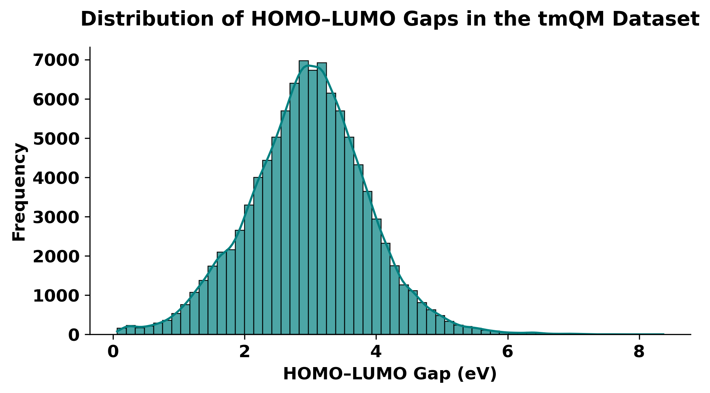
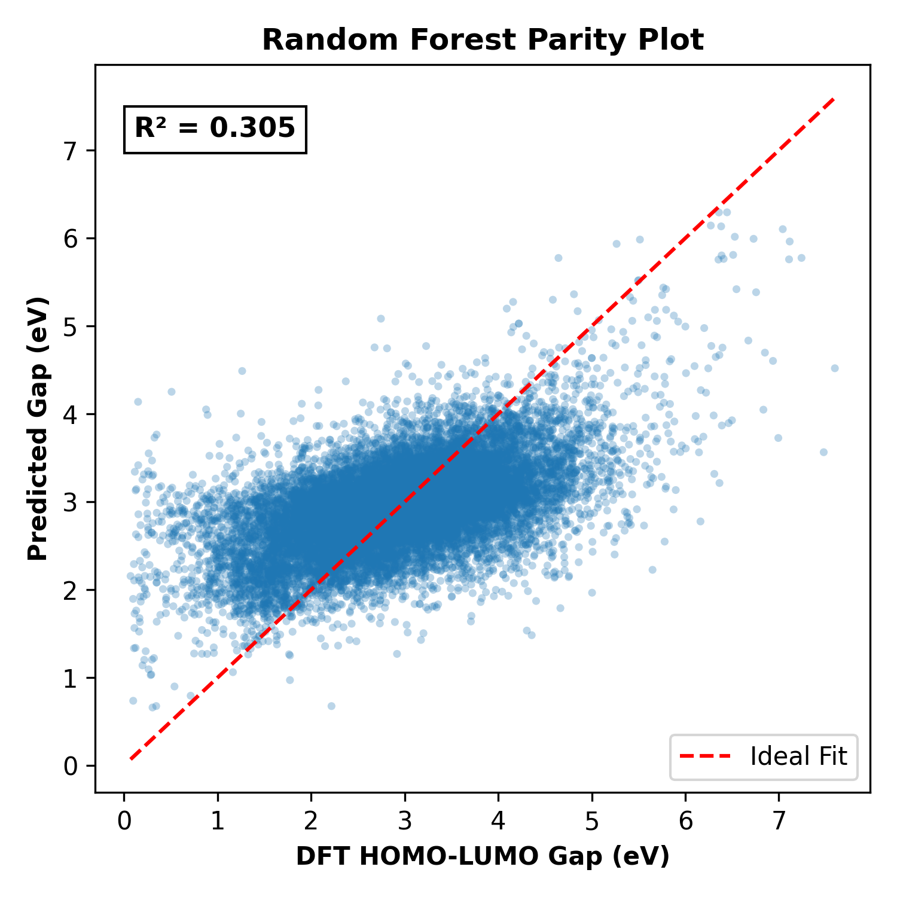
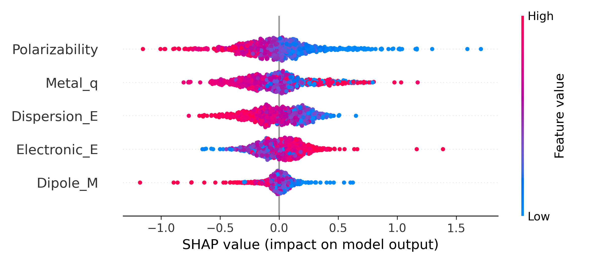

\# Quantifying the Applicability Domain of Non-Spatial ML Models on tmQM

[](https://www.python.org/downloads/)
[](https://opensource.org/licenses/MIT)

## 📖 Citation
If you use this code or the corrected data alignment in your research, please cite our paper:

> **Muhammad Kashan Ali.** *Quantifying the Applicability Domain of Non-Spatial Machine Learning Models for HOMO–LUMO Gap Prediction on the tmQM Dataset.* (in preparation, 2024).

---

## 📌 Overview
This repository contains the data preprocessing, model training, and evaluation pipeline for our study on the 2024 release of the tmQM dataset. 

While recent literature has demonstrated that 3D Graph Neural Networks (GNNs) can achieve high accuracy (\(R^2 \approx 0.77\)) by learning spatial ligand-field geometries, the extrapolative limits of standard non-spatial models remain undefined. 

**Core Finding:** We demonstrate that non-spatial machine learning models (global scalars and 2D descriptors) reach an empirical ceiling of \(R^2 \approx 0.31\) under random cross-validation. Crucially, when evaluated on unseen transition metals via GroupKFold validation, performance catastrophically collapses, proving these models have near-zero extrapolative power and justifying the computational cost of 3D GNN architectures.

## 📊 Dataset & Features
- **Source:** [tmQM 2024 release](https://github.com/uiocompcat/tmqm) — `tmQM/tmQM_y.csv`
- **Complexes:** 108,541
- **Unit Conversion:** The target `HL_Gap` is stored in Hartree. To ensure physical interpretability, we apply the standard **27.2114** conversion factor to eV (yielding a median gap of 2.97 eV).
- **Aligned Dataset:** To ensure a fair comparison, all models were evaluated on exactly 100,831 complexes (removing those without valid SMILES).

**Feature Sets Benchmarked:**
1. **5 Scalars:** `Electronic_E`, `Dispersion_E`, `Dipole_M`, `Metal_q`, `Polarizability`.
2. **RDKit 2D:** 14 topological descriptors (e.g., MolWt, LogP, TPSA).

## 🏆 Benchmark Results

**Random 5-Fold Cross-Validation (In-Distribution)**
<table>
  <tr>
    <th>Features</th>
    <th>Model</th>
    <th>R²</th>
    <th>RMSE (eV)</th>
  </tr>
  <tr>
    <td>5 Scalars</td>
    <td>Random Forest</td>
    <td><b>0.2983</b></td>
    <td>0.7595</td>
  </tr>
  <tr>
    <td>5 Scalars</td>
    <td>XGBoost</td>
    <td>0.2712</td>
    <td>0.7740</td>
  </tr>
  <tr>
    <td>RDKit 2D</td>
    <td>Random Forest</td>
    <td><b>0.3074</b></td>
    <td>0.7545</td>
  </tr>
  <tr>
    <td>RDKit 2D</td>
    <td>XGBoost</td>
    <td>0.2702</td>
    <td>0.7746</td>
  </tr>
</table>

**GroupKFold Validation (Out-of-Distribution by Metal)**
<table>
  <tr>
    <th>Features</th>
    <th>Model</th>
    <th>R²</th>
    <th>RMSE (eV)</th>
  </tr>
  <tr>
    <td>5 Scalars</td>
    <td>Random Forest</td>
    <td><b>0.0946</b></td>
    <td>0.8627</td>
  </tr>
  <tr>
    <td>5 Scalars</td>
    <td>XGBoost</td>
    <td>0.1183</td>
    <td>0.8514</td>
  </tr>
  <tr>
    <td>RDKit 2D</td>
    <td>Random Forest</td>
    <td><b>0.1425</b></td>
    <td>0.8396</td>
  </tr>
  <tr>
    <td>RDKit 2D</td>
    <td>XGBoost</td>
    <td>0.1465</td>
    <td>0.8377</td>
  </tr>
</table>

## 🖼️ Publication Figures

### Corrected Gap Distribution
*The physically realistic distribution of gaps (1-8 eV) confirms the unit conversion.*


### Random Forest Parity Plot
*The model fails to predict extreme gaps (> 5 eV) and collapses to the mean (R² = 0.305).*


### SHAP Feature Importance
*SHAP confirms the model relies on global atomic properties (`Polarizability`, `Electronic_E`) rather than local geometry.*



## 📂 Repository Structure
```text
├── gap_distribution.png          # Corrected HOMO-LUMO gap distribution (eV)
├── parity_plot_final.png         # Random Forest parity plot (R² = 0.305)
├── shap_summary_final.png        # SHAP summary plot for 5-scalar model
├── run_pipeline.py               # Main execution pipeline
├── requirements.txt              # Python dependencies
├── LICENSE
└── README.md
