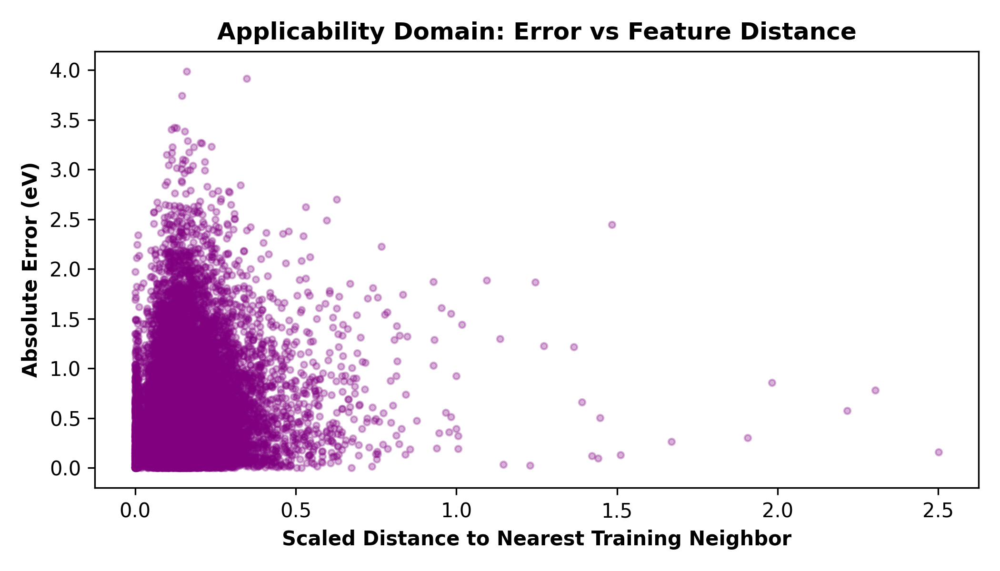
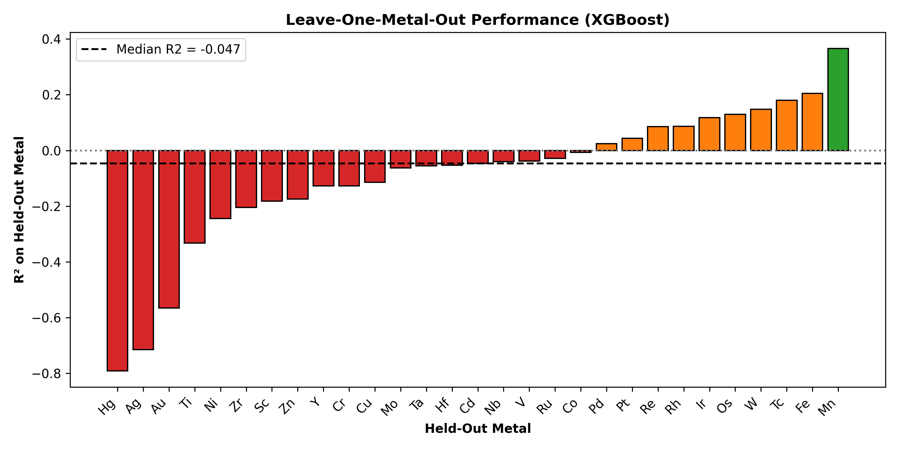

<h1>Benchmarking the Out-of-Distribution Extrapolation Limits of Non-Spatial ML Models on tmQM</h1>

  
  

<h2>📖 Citation</h2>

If you use this code or the corrected data alignment in your research, please cite our paper:

<blockquote>
  
<strong>Muhammad Kashan Ali.</strong> <em>Benchmarking the Out-of-Distribution Extrapolation Limits of Non-Spatial Machine Learning Models on the tmQM Dataset.</em> (in preparation, 2026).

</blockquote>

<h2>🖼️ Publication Figures</h2>

<h3>1. Corrected Gap Distribution</h3>

<em>The physically realistic distribution of gaps (1-8 eV) confirms the unit conversion.</em>

<h3>2. Random Forest Parity Plot</h3>

<em>The model fails to predict extreme gaps (> 5 eV) and collapses to the mean.</em>

<h3>3. SHAP Feature Importance</h3>

<em>SHAP confirms the model relies on global atomic properties rather than local geometry.</em>

<h3>4. Applicability Domain Analysis</h3>

<em>Error increases significantly as test molecules move further from the training manifold (scaled kNN distance).</em>

<h3>5. Leave-One-Metal-Out Analysis</h3>

<em>The model catastrophically fails on unseen metals like Hg (R² = -0.77) and Ag (R² = -0.70), while maintaining some accuracy on Mn (R² = 0.35).</em>

<h2>📌 Overview</h2>

This repository contains the data preprocessing, model training, and evaluation pipeline for our study on the 2024 release of the tmQM dataset.

<strong>Core Finding:</strong> We demonstrate that non-spatial machine learning models (global scalars, 2D descriptors, and Morgan fingerprints) reach an empirical ceiling of <b>R² ≈ 0.39</b> under random cross-validation. Crucially, when evaluated on unseen transition metals via GroupKFold validation, performance catastrophically collapses (e.g., Morgan fingerprints drop from 0.3732 to 0.2009), proving these models have near-zero extrapolative power and justifying the computational cost of 3D GNN architectures.

<h2>📊 Dataset & Features</h2>
<ul>
  <li><strong>Source:</strong> tmQM 2024 release — <code>tmQM/tmQM_y.csv</code></li>
  <li><strong>Complexes:</strong> 108,541</li>
  <li><strong>Unit Conversion:</strong> The target <code>HL_Gap</code> is stored in Hartree. To ensure physical interpretability, we apply the standard <strong>27.2114</strong> conversion factor to eV.</li>
  <li><strong>Aligned Dataset:</strong> To ensure a fair comparison, all models were evaluated on exactly 100,831 complexes (removing those without valid SMILES).</li>
</ul>

<h2>🏆 Benchmark Results</h2>

<h3>Random 5-Fold Cross-Validation (In-Distribution)</h3>
<table>
  <tr>
    <th>Features</th><th>Model</th><th>R²</th><th>RMSE (eV)</th><th>MAE (eV)</th>
  </tr>
  <tr><td>5 Scalars</td><td>Random Forest</td><td>0.2983</td><td>0.7595</td><td>0.5784</td></tr>
  <tr><td>5 Scalars</td><td>XGBoost</td><td>0.2712</td><td>0.7740</td><td>0.5949</td></tr>
  <tr><td>RDKit 2D</td><td>Random Forest</td><td>0.3074</td><td>0.7545</td><td>0.5717</td></tr>
  <tr><td>RDKit 2D</td><td>XGBoost</td><td>0.2702</td><td>0.7746</td><td>0.5919</td></tr>
  <tr><td>Morgan FP</td><td>Random Forest</td><td><b>0.3860</b></td><td><b>0.7105</b></td><td><b>0.5261</b></td></tr>
  <tr><td>Morgan FP</td><td>XGBoost</td><td><b>0.3732</b></td><td><b>0.7178</b></td><td><b>0.5372</b></td></tr>
</table>

<h3>GroupKFold Validation (Out-of-Distribution by Metal)</h3>
<table>
  <tr>
    <th>Features</th><th>Model</th><th>R²</th><th>RMSE (eV)</th><th>MAE (eV)</th>
  </tr>
  <tr><td>5 Scalars</td><td>Random Forest</td><td>0.0946</td><td>0.8627</td><td>0.6636</td></tr>
  <tr><td>5 Scalars</td><td>XGBoost</td><td>0.1183</td><td>0.8514</td><td>0.6550</td></tr>
  <tr><td>RDKit 2D</td><td>Random Forest</td><td>0.1425</td><td>0.8396</td><td>0.6414</td></tr>
  <tr><td>RDKit 2D</td><td>XGBoost</td><td>0.1465</td><td>0.8377</td><td>0.6411</td></tr>
  <tr><td>Morgan FP</td><td>Random Forest</td><td>0.1836</td><td>0.8192</td><td>0.6228</td></tr>
  <tr><td>Morgan FP</td><td>XGBoost</td><td><b>0.2009</b></td><td><b>0.8105</b></td><td><b>0.6168</b></td></tr>
</table>

<h2>🚀 Reproducing the Results</h2>
<pre><code>pip install -r requirements.txt
python run_pipeline.py
</code></pre>
