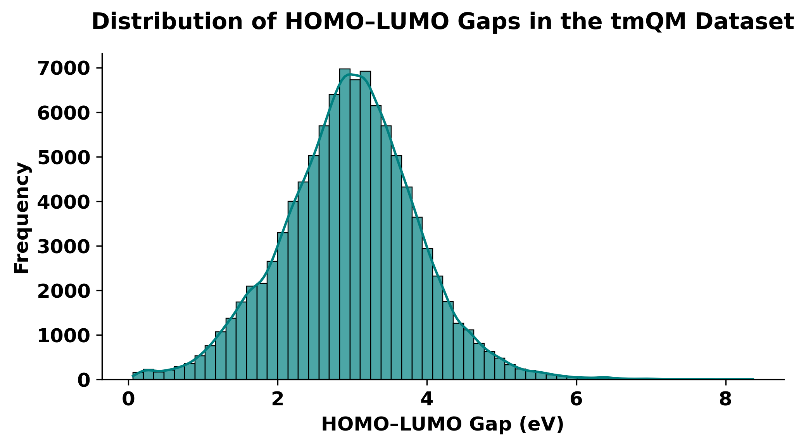
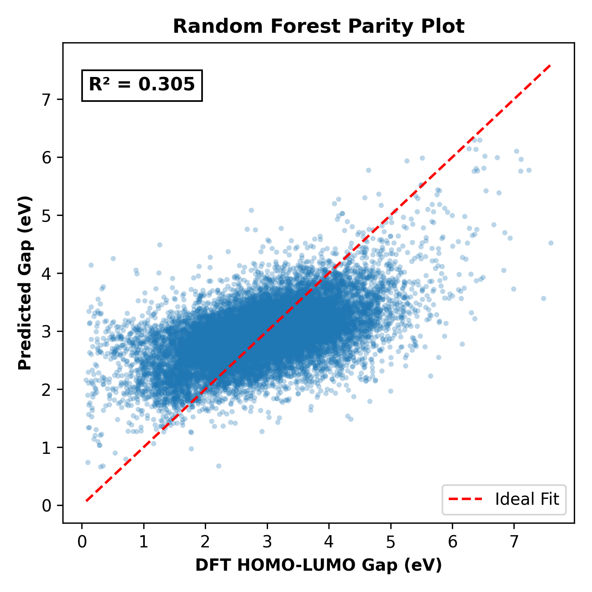
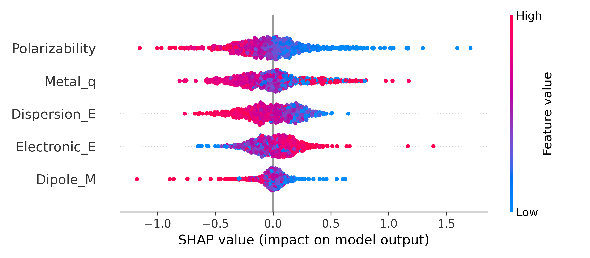
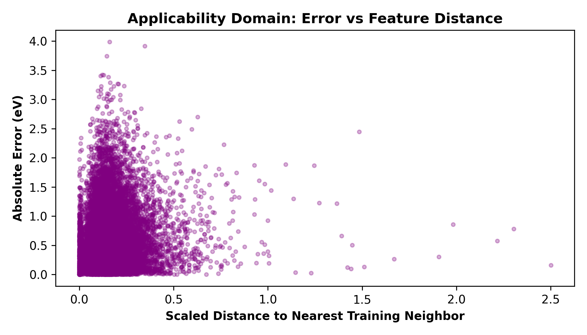

# Benchmarking the Out-of-Distribution Extrapolation Limits of Non-Spatial ML Models on tmQM

> Predicting the HOMO–LUMO gap of transition-metal complexes from composition alone — and where that fails.

[](https://www.python.org/)
[](LICENSE)

**Status:** benchmark archive. The results below are the verified numbers from the
runs in `results/`. There is no paper in preparation from this project — the work
is kept here as a complete, honest benchmark, including its negative result.

## Core finding

Non-spatial models barely predict the tmQM HOMO–LUMO gap, even when they are
given help. The best model (Random Forest) reaches **R² ≈ 0.33–0.38 on a random
split** and collapses to **R² ≈ 0.07–0.15 on grouped (by-metal) splits**. Under
leave-one-metal-out, the median metal scores **R² = −0.048** — worse than
predicting the mean. Cheap xTB-only features fail outright (R² ≈ 0.03, Random
Forest −0.20). The gap is not predictable from these inputs, and it does not
transfer to unseen metals.

## Read this first — what the numbers do and do not mean

- **The 5 "DFT scalars" are oracle features, not screening features.**
  `Electronic_E`, `Dispersion_E`, `Dipole_M`, `Metal_q` (and `Polarizability`)
  come from the same TPSSh calculation as the HOMO–LUMO gap itself. A model
  using them is a DFT-to-DFT mapping: it cannot be used to screen new complexes
  without first running the expensive calculation it is supposed to replace.
  The feature-importance file proves the point — the model leans almost
  entirely on these five numbers (see below).
- **The honest screening numbers are the structure-only ones** (RDKit 2D
  descriptors, Morgan fingerprints). They are no better: RDKit 2D Random
  Forest reaches R² 0.379 random / 0.149 grouped.
- **Morgan-fingerprint results are verified — by a fresh rerun.** The
  earlier version of this README quoted Morgan FP numbers (R² 0.386 random /
  0.201 grouped) with no source table in the bundle, so they were removed.
  On 2026-11-27 the pipeline was rerun end-to-end and reproduced those
  numbers to within 0.001 (see `results/results_cv_reproduced.csv`). The
  Morgan table is therefore restored below. Note the rerun used **256-bit**
  fingerprints; the surviving `X_morgan.parquet` is 1024-bit from a
  different run and is not the file this table used.
- **Two unit systems are mixed in the files.** `benchmark_results.csv` and
  `results_cv.csv` report errors in **eV**; `model_results.csv` reports the
  same runs with the target in **Hartree** (RMSE ≈ 0.027 Ha ≈ 0.75 eV).
  R² is identical in both; only the error scale differs.

## Dataset and features

- **Source:** tmQM dataset, HOMO–LUMO gap (`HL_Gap`) from TPSSh calculations.
- **Complexes:** 108,541 in total; **100,831** with valid SMILES (the rest
  drop out of any SMILES-based featurisation, which is why the N differs
  between runs below).
- **Target:** `HL_Gap_eV` = `HL_Gap` × 27.2114. Mean 2.97 eV, std 0.91 eV,
  range 0.06–8.37 eV (N = 100,831).
- **Feature sets:**
  - 5 DFT scalars: `Electronic_E`, `Dispersion_E`, `Dipole_M`, `Metal_q`,
    `Polarizability` (same calculation as the target — see the caveat above).
  - RDKit 2D: 14 descriptors (MolWt, LogP, TPSA, …).
  - Morgan fingerprints: 1024 bits (feature file only; no results table here).
  - xTB-only: as recorded in `benchmark_results.csv`; its feature file is not
    in this bundle.

## Benchmark results

### Random 80/20 splits, seeds 42 / 123 / 2024 (N = 108,541; train 86,832, test 21,709)

From `results/benchmark_results.csv` (seed 42 shown; the range over the three
seeds is in brackets).

| Features | Model | R² | RMSE (eV) | MAE (eV) |
|---|---|---|---|---|
| DFT-assisted (5 scalars) | Dummy (mean) | 0.000 | 0.916 | 0.708 |
| DFT-assisted (5 scalars) | Ridge | 0.086 | 0.876 | 0.671 |
| DFT-assisted (5 scalars) | Random Forest | **0.334** [0.322–0.336] | 0.748 | 0.560 |
| DFT-assisted (5 scalars) | XGBoost | 0.274 [0.263–0.277] | 0.781 | 0.600 |
| xTB-only | Dummy (mean) | 0.000 | 0.916 | 0.708 |
| xTB-only | Ridge | 0.019 | 0.908 | 0.703 |
| xTB-only | Random Forest | −0.200 | 1.004 | 0.781 |
| xTB-only | XGBoost | 0.031 | 0.902 | 0.698 |

### 5-fold cross-validation, rerun 2026-11-27 (from `results/results_cv_reproduced.csv`)

Aligned set: 100,831 complexes with valid SMILES, known metals only, 30
metals, median gap 2.98 eV. Random = 5-fold KFold; grouped = 5-fold
GroupKFold by metal. Morgan fingerprints are 256-bit here. The mean baseline
scores R² 0.000 (random) and −0.006 (grouped).

| Split | Features | Model | R² | RMSE (eV) | MAE (eV) |
|---|---|---|---|---|---|
| random | 5 scalars | Ridge | 0.082 | 0.869 | 0.666 |
| random | 5 scalars | Random Forest | 0.299 | 0.759 | 0.579 |
| random | 5 scalars | XGBoost | 0.271 | 0.774 | 0.595 |
| random | RDKit 2D | Ridge | 0.116 | 0.853 | 0.659 |
| random | RDKit 2D | Random Forest | 0.309 | 0.754 | 0.571 |
| random | RDKit 2D | XGBoost | 0.271 | 0.774 | 0.592 |
| random | Morgan FP (256) | Ridge | 0.256 | 0.782 | 0.597 |
| random | Morgan FP (256) | Random Forest | **0.386** | 0.711 | 0.527 |
| random | Morgan FP (256) | XGBoost | 0.374 | 0.718 | 0.537 |
| grouped (by metal) | 5 scalars | Ridge | 0.032 | 0.892 | 0.684 |
| grouped (by metal) | 5 scalars | Random Forest | 0.096 | 0.862 | 0.664 |
| grouped (by metal) | 5 scalars | XGBoost | 0.118 | 0.851 | 0.655 |
| grouped (by metal) | RDKit 2D | Ridge | 0.056 | 0.881 | 0.681 |
| grouped (by metal) | RDKit 2D | Random Forest | 0.143 | 0.840 | 0.641 |
| grouped (by metal) | RDKit 2D | XGBoost | 0.147 | 0.838 | 0.641 |
| grouped (by metal) | Morgan FP (256) | Ridge | 0.134 | 0.844 | 0.650 |
| grouped (by metal) | Morgan FP (256) | Random Forest | 0.184 | 0.819 | 0.623 |
| grouped (by metal) | Morgan FP (256) | XGBoost | **0.201** | 0.811 | 0.617 |

This rerun reproduces the numbers the old README reported to within 0.001
on every row — that is why the Morgan table is back. Note these numbers
differ from the older `results_cv.csv` table (5 scalars RF 0.330, RDKit RF
0.379): that file comes from a different run with different model settings,
and both are kept in `results/` with their sources documented. Do not mix
the two tables.

### Older cross-validation summary (from `results/results_cv.csv`)

Kept for completeness; a different run from the table above (see
`docs/tmqm_benchmark_report.md`).

| Split | Features | Model | N | R² | RMSE (eV) |
|---|---|---|---|---|---|
| random | 5 scalars | Ridge | 108,541 | 0.082 | 0.875 |
| random | 5 scalars | Random Forest | 108,541 | 0.330 | 0.748 |
| random | 5 scalars | XGBoost | 108,541 | 0.271 | 0.780 |
| random | RDKit 2D | Ridge | 100,831 | 0.116 | 0.852 |
| random | RDKit 2D | Random Forest | 100,831 | 0.379 | 0.715 |
| random | RDKit 2D | XGBoost | 100,831 | 0.271 | 0.774 |
| grouped (by metal) | 5 scalars | Ridge | 100,849 | 0.032 | 0.892 |
| grouped (by metal) | 5 scalars | Random Forest | 100,849 | 0.070 | 0.874 |
| grouped (by metal) | 5 scalars | XGBoost | 100,849 | 0.126 | 0.848 |
| grouped (by metal) | RDKit 2D | Ridge | 100,831 | 0.056 | 0.881 |
| grouped (by metal) | RDKit 2D | Random Forest | 100,831 | 0.149 | 0.836 |
| grouped (by metal) | RDKit 2D | XGBoost | 100,831 | 0.149 | 0.837 |

Note the N differences: the 5-scalar runs use all 108,541 rows (scalars need no
SMILES); RDKit runs use the 100,831 rows with valid SMILES. The grouped
5-scalar N (100,849) differs slightly from the random N — the runs come from
different pipeline stages, so treat the two tables as two recorded runs, not
one perfectly matched experiment. See `docs/tmqm_benchmark_report.md`.

### Leave-one-metal-out (XGBoost, from `per_metal_r2.png`)

Median R² over held-out metals: **−0.048**. Worst: Hg ≈ −0.77, Ag ≈ −0.70,
Au ≈ −0.56. Best: Mn ≈ 0.35. These values are read from the figure — no
per-metal results table survives in this bundle.

### Feature importance (Random Forest, DFT-assisted)

From `results/feature_importance.csv` — the five scalars take all of the
credit, which is the oracle problem in one table:

| Feature | Importance |
|---|---|
| Metal_q | 0.265 |
| Electronic_E | 0.212 |
| Polarizability | 0.185 |
| Dipole_M | 0.177 |
| Dispersion_E | 0.161 |

## Figures

### 1. Gap distribution



### 2. Random Forest parity plot

*The model fails to predict extreme gaps (> 5 eV) and collapses to the mean.*



### 3. SHAP feature importance

*SHAP confirms the model relies on global atomic properties rather than local
geometry.*



### 4. Applicability domain

*Error increases significantly as test molecules move further from the training
manifold (scaled kNN distance).*



### 5. Leave-one-metal-out analysis

*The model catastrophically fails on unseen metals like Hg (R² = −0.77) and Ag
(R² = −0.70), while maintaining some accuracy on Mn (R² = 0.35).*


## Reproducing the results

```bash
pip install -r requirements.txt
python run_pipeline.py
```

`run_pipeline.py` is the cleaned pipeline for the 5-fold CV part (random +
grouped, 5 scalars / RDKit 2D / 256-bit Morgan FP, aligned on the common
valid index). **It does not reproduce the tables in `results/` exactly:**
the 80/20 benchmark tables (`benchmark_results.csv`, `model_results.csv`,
`rf_predictions.csv`) and the `xTB_only` rows come from earlier Colab runs
whose script is not in this repo, and `results_cv.csv` was run on the full
108,541-row set while this pipeline aligns to the ~100,831-row common index.
The pipeline also uses 256-bit Morgan fingerprints, while the surviving
feature file is 1024-bit. See `docs/tmqm_benchmark_report.md` for the full
code audit. The large feature files (parquet) are not in this repo —
regenerate them with the pipeline.

## Files

```
├── run_pipeline.py          # Pipeline code
├── requirements.txt
├── results/
│   ├── benchmark_results.csv       # 80/20 splits, seeds 42/123/2024, eV
│   ├── results_cv.csv              # Older CV summary, eV (different run)
│   ├── results_cv_reproduced.csv   # 5-fold CV rerun 2026-11-27, eV (Morgan 256-bit)
│   ├── model_results.csv           # Same runs as benchmark_results, in Hartree
│   ├── model_summary.csv           # Mean ± std over seeds
│   ├── feature_importance.csv      # RF importances (5 DFT scalars)
│   ├── rf_predictions.csv          # RF actual vs predicted, eV (test split)
│   └── README.md                   # Guide to the files and their units
└── docs/
    └── tmqm_benchmark_report.md    # Verification report: what was checked,
                                    # what matches, what is missing
```

## Author

**Muhammad Kashan Ali** — Department of Chemistry, Bahauddin Zakariya
University, Multan, Pakistan.

## License

MIT — see [LICENSE](LICENSE).
